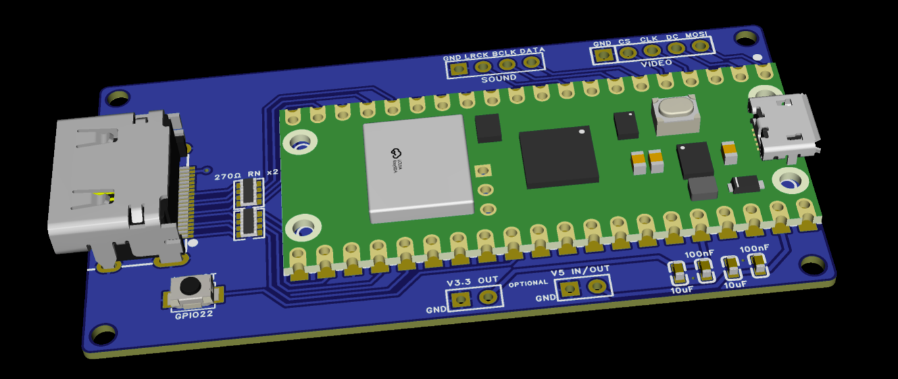

# Dev PCB

Heres the gerber for a simple dev board for this project. 

# BOM:

RP2350 (Original or 'Clone'): https://www.aliexpress.com/item/1005009890100985.html

HDMI Ports: https://www.aliexpress.com/item/1005001412266648.html

3X4X2mm 2Pin Button: https://www.aliexpress.com/item/4001317902663.html

100nF & 10uF 0603 Caps: https://www.aliexpress.com/item/32966526545.html

270Ohm Resistor Arrays: https://www.aliexpress.com/item/1005005580079760.html

Caps are optional if you're not intending to use the 5v or 3.3v in/outputs. You can just power directly from USB. You'll also need some pin headers if you want to use dupont connectors or a breadboard. I would recommend doing the resistor arrays first, these are tricky so use plenty of flux. Then do the HDMI port, followed by the RP2350.

