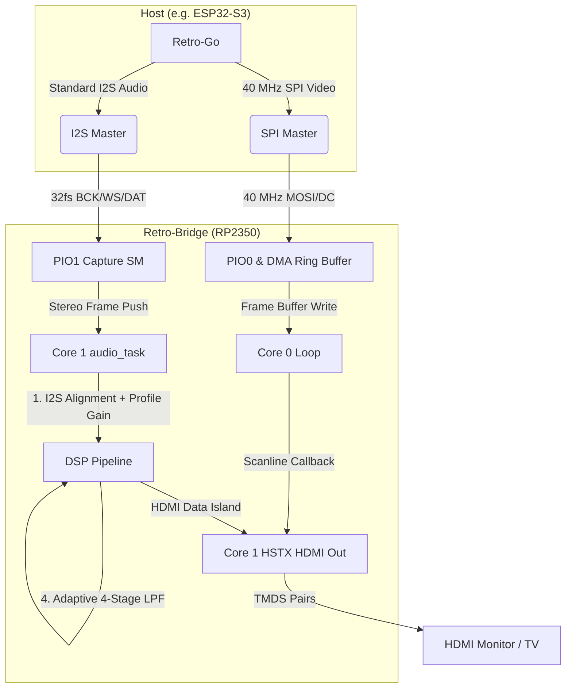

# RP2350 SPI-to-HDMI Converter

This project converts a Raspberry Pi Pico 2 (RP2350) into a transparent digital-to-digital bridge. It captures high-speed SPI video signals (ILI9341/ST7789 LCD protocol) and I2S digital audio from a host controller (such as an ESP32-S3 running Retro-Go) and outputs a standard 640x480p HDMI signal with fully integrated digital audio. **Note:** This has been specifically designed around a Retro-Go system and how it outputs SPI signals & I2S audio and has not been tested on any other device or system, however, in theory, it will work on other systems as long as the SPI output matches.

---

## Features
* **High-Speed SPI Video Capture:** Efficiently processes 16-bit RGB565 pixel streams at up to 40 MHz SPI clock speeds using RP2350 PIO and DMA.
* **Scanline-Doubled Video Output:** Upscales a 320x240 LCD output to standard 640x480p (60Hz, VIC 1) using scanline doubling.
* **Aspect Ratio Modes:** Support for dynamic 4:3 Pillarbox and 16:9 Stretch modes, toggleable via a hardware button.
* **Lookup Table (LUT) Brightness/Gamma Correction:** Enhances readability in dark games (e.g., Doom) using approximately 4.1 KiB of channel-separated lookup tables for gamma correction and shadow boosting without highlight clipping. The full 128 KiB pixel LUT is compiled only when non-default color saturation is requested.
* **Standard I2S Stereo Audio Capture:** Implements robust edge-triggered Standard I2S capture on a second PIO state machine.
* **Linear Interpolation Sample Rate Converter (SRC):** Tracks the incoming I2S rate and converts it to the 48kHz HDMI audio standard.
* **Profile-Selected DSP Filtering:**
  * **DC Blocker:** Centers the waveform to eliminate offset clicks and pops.
  * **4-Stage Low-Pass Filter (LPF):** Automatically adjusts cutoff frequencies based on measured physical rate and display aspect ratio (e.g., ~1200Hz LPF for Doom to remove upsampling hiss, ~2000Hz LPF for Gameboy to smooth square waves, and pure bypass for Atari Lynx).

---

## How It Works



### Video Pipeline
Core 0 runs the SPI state machine parser. Pixel bytes are transferred through a 16KB DMA ring buffer to absorb high-speed bursts while the parser updates the framebuffer. It decodes standard display commands (0x2A for column address, 0x2B for row address, and 0x2C for RAM write) and populates a 320x240 RGB565 framebuffer. Core 1 generates the HDMI output, doubling scanlines and adding pillarboxes if in 4:3 mode.

### Audio Pipeline
Core 1 runs the `audio_task` in the scanline blanking intervals. The RP2350 acts as an I2S slave, synchronizing to the host's word select (WS) and bit clock (BCK). The captured samples are aligned and given profile-specific input gain, processed through a DC blocker, converted to 48kHz via a linear phase accumulator, filtered according to the selected profile, and then packed into HDMI Data Island packets.

---

## Hardware Wiring Guide

The Pico 2 (RP2350) pins are configured as follows:

| Signal Name | Pico 2 GPIO | Wire Color / PCB Label | Description |
| :--- | :---: | :---: | :--- |
| **SPI MOSI** | **0** | MOSI / SDA | ILI9341/ST7789 Serial Data Line |
| **SPI D/C** | **1** | D/C / RS | Data / Command Selection |
| **SPI CLK** | **2** | SCLK / SCK | SPI Serial Clock |
| **SPI CS** | **3** | CS | Display Chip Select |
| **I2S DATA** | **4** | I2S_DIN / DAT | Digital Audio Serial Data |
| **I2S BCK** | **5** | I2S_BCK / CLK | Digital Audio Bit Clock |
| **I2S WS** | **6** | I2S_LRC / WS | Digital Audio Word Select |
| **HDMI TXC-** | **12** | TXC- | HDMI Clock Pair (Negative) |
| **HDMI TXC+** | **13** | TXC+ | HDMI Clock Pair (Positive) |
| **HDMI TX0-** | **14** | TX0- | Blue/Sync Channel (Negative) |
| **HDMI TX0+** | **15** | TX0+ | Blue/Sync Channel (Positive) |
| **HDMI TX1-** | **16** | TX1- | Green Channel (Negative) |
| **HDMI TX1+** | **17** | TX1+ | Green Channel (Positive) |
| **HDMI TX2-** | **18** | TX2- | Red Channel (Negative) |
| **HDMI TX2+** | **19** | TX2+ | Red Channel (Positive) |
| **ASPECT BTN**| **22** | BTN | Grounding button toggles 4:3/16:9 |

---

## Hardware Compatibility & Acoustic Noise Note

Due to high-speed differential TMDS signal generation (252 MHz HSTX pin switching on GPIO 12–19), some third-party RP2350 development boards may exhibit physical **acoustic coil whine / capacitor hum**. This is a mechanical hardware characteristic caused by lower-grade decoupling capacitors (piezoelectric effect) under rapid $dI/dt$ power rail switching.

### Tested Board Results:
* **Original Raspberry Pi Pico 2**: **Quiet / No Issue**
* **WeActStudio RP2350 (V10)**: **Quiet / No Issue**
* **WeActStudio RP2350 (V20)**: **Quiet / No Issue**
* **Waveshare RP2350-Plus**: **Quiet / No Issue**
* **Generic Red RP2350 (AliExpress)**: **Exhibits Coil Whine** (Physical capacitor vibration under HSTX pin switching)

If you experience acoustic whine, it is purely mechanical component vibration on that specific board design and does not affect functionality or longevity. For a silent hardware setup, we recommend using an **Original Raspberry Pi Pico 2** or one of the above boards.

> **Hardware Mitigation Tip:** If using a board with acoustic whine, applying a small dab of non-conductive **hot glue** directly over the crystal oscillator package and its surrounding load capacitors acts as a mechanical potting/damping compound, significantly muffling or silencing the acoustic vibrations.


---

## Developer Integration Guide

### 1. Adapting to Non-Retro-Go Projects
You can connect this bridge to any microcontroller (e.g., STM32, ESP32, Arduino) that outputs SPI display signals and/or I2S audio.

#### Expected SPI Display Protocol:
The PIO decoder expects an emulation of the **ILI9341/ST7789** controller. The host must send commands by driving the D/C (Data/Command) line Low, and data by driving it High.
* **Column Address Set (0x2A):** Followed by 4 bytes (Start Column MSB/LSB, End Column MSB/LSB).
* **Row Address Set (0x2B):** Followed by 4 bytes (Start Row MSB/LSB, End Row MSB/LSB).
* **RAM Write (0x2C):** Followed by a stream of 16-bit RGB565 pixels (2 bytes per pixel, MSB first).

If your host project uses a different display driver, it may work out-of-the-box as long as it uses the same standard address commands (0x2A, 0x2B, 0x2C).

#### Expected I2S Audio Protocol:
The audio capture module expects **Standard I2S** (MSB-first, 16-bit stereo, 32fs frame structure). 
* **WS Polarity:** WS Low is the Left channel, WS High is the Right channel.
* **Clock delay:** There must be a 1-clock cycle delay between the WS transition and the start of the MSB.
* **Sign representation:** Data should be standard 16-bit signed integers (two's complement).
* **Clock rates:** The bridge automatically tracks and converts input sample rates between **8 kHz** and **192 kHz**. The supplied audio profiles have been hardware-tested with Retro-Go's approximately 22 kHz and 32 kHz outputs.

### 2. Custom Configurations
Several macros at the top of src/main.c allow you to configure behavior:

* **`ASPECTBUTTON`:** Change this to redirect the aspect ratio button toggle pin:
* **Core Voltage Regulation:** You can adjust the internal core voltage regulator setting to reduce power consumption or acoustic coil whine on certain third-party RP2350 boards:
  ```c
  #define VREG_VOLTAGE_LEVEL VREG_VOLTAGE_1_20 // Default: 1.20V 
  ```
  Options include `VREG_VOLTAGE_1_10` (1.10V), `VREG_VOLTAGE_1_15` (1.15V), or `VREG_VOLTAGE_1_20` (1.20V).
* **Audio Volume Gain:** You can adjust the post-profile output scaling percentage:
  ```c
  #define AUDIO_VOLUME_PERCENT         100     // 100 = 100% (default), 120 = 120% (+20% boost)
  ```
  Values above 100 boost the volume (e.g. `120` for +20% boost, `150` for +50% boost). Built-in overflow clamping prevents digital clipping distortion. Profile-specific unity or 2x input gain is selected separately. When set to `100`, this additional volume calculation compiles out completely for zero overhead.
* **Image Correction:** You can adjust overall image brightness, shadow boost, and color saturation (vibrancy):
  ```c
  #define ENABLE_BRIGHTNESS_CORRECTION 1
  #define BRIGHTNESS_GAMMA             0.9f   // Lower = more detail in dark areas
  #define BRIGHTNESS_GAIN              1.0f    // Scales overall brightness
  #define BRIGHTNESS_OFFSET            2       // Flat offset added to black levels
  #define COLOR_SATURATION             256     // 256 = default, < 256 = muted, > 256 = boosted
  ```
  
  **Color Saturation Control:**
  The `COLOR_SATURATION` option allows you to scale the vibrancy of the colors. 
  - `256` represents 100% default saturation.
  - Setting this to a lower value (e.g., `204` for 80% saturation) will mute/soften the colors to prevent them from looking overly rich on highly saturated screens like TVs.
  - Setting this to a higher value (e.g., `300`) will boost the colors.
  - When set to `256` (the default), the entire saturation algorithm compiles out completely to guarantee **absolute zero performance overhead** in the hot pixel loop.

* **Audio Profiles:** Profile selection is defined and documented in `src/audio_profiles.c`, with the public types in `include/audio_profiles.h`. Rules are applied in this order so that a specific video override can inherit a broad sample-rate filter:

  | Profile/rule | Match | Input gain | Low-pass filter |
  | :--- | :--- | :---: | :---: |
  | Default | 36 kHz and above, or no lower-rate match | 2x | Bypass |
  | Low-rate / Doom | Below 24 kHz | 2x | ~1200 Hz |
  | Game Boy | 24–36 kHz with a narrow active window | 2x | ~2000 Hz |
  | Lynx | 24–36 kHz with height 102/204 or aspect ratio at least 1.3:1 | 2x | Bypass |
  | Celeste override | 320x182 active window | Unity | Inherits the rate-selected filter |

  To support a source that needs different treatment, add a readable rate/aspect rule or a later video-specific override in `audio_profile_select()`. Keep the default unchanged so sources without a special requirement retain the established behaviour. Address windows can represent partial updates as well as full frames, so test menu transitions and gameplay before relying on a new dimension rule.

* **Diagnostics Logging:** Event-driven diagnostics can report video acquisition/loss, stable address-window changes, audio activity, selected audio profiles, PIO stalls, invalid windows, HDMI queue throttling, and a compact health summary every 10 seconds. Transient window activity is counted in the health line without flooding the serial output. Enable the diagnostic code and USB COM port together when configuring the build:
  ```bash
  cmake -S . -B build -G Ninja -DCMAKE_BUILD_TYPE=Release -DSPI_TO_HDMI_DIAGNOSTICS=ON
  ```
  Compile, flash, and connect to the Pico 2 using any serial monitor (e.g. PuTTY or Arduino Serial Monitor). A setting such as `115200` baud may be used, although USB CDC does not depend on that baud value. USB writes are limited to 1 ms and deferred until an SPI-idle gap to protect real-time video capture. If a source provides no safe gap, messages may be delayed or omitted rather than interrupting video. Set the option to `OFF` for normal builds; diagnostics and USB serial are then compiled out.

  The compact `HEALTH` fields are:

  | Field | Meaning |
  | :--- | :--- |
  | `spi`, `payload` | Estimated active SPI clock and average payload throughput |
  | `writes` | RAM-write (`0x2C`) commands per second; this is not necessarily display refresh rate |
  | `windows` | Row-address windows observed during the reporting interval, including partial updates |
  | `backlog` | Maximum pending entries observed in the 4,096-entry SPI DMA ring |
  | `audio`, `rate`, `queue` | I2S stream activity, tracked input rate, and current HDMI audio queue level |
  | `throttles` | HDMI audio samples intentionally dropped while the queue was full |
  | `vstall`, `astall`, `badwin` | Cumulative video/audio PIO stall observations and invalid address windows |

  `AUDIO active` means I2S frames are arriving; the samples may still contain digital silence. Stable abnormal audio rates and SPI clocks above 45 MHz generate separate `WARN` lines.

### 3. Compilation
To build the project, use the standard Raspberry Pi Pico CMake workflow:
```bash
# Configure the build directory
cmake -S . -B build -G Ninja -DCMAKE_BUILD_TYPE=Release

# Build the binary
cmake --build build --config Release
```
This produces `build/spi_to_hdmi.uf2` which can be flashed onto your Pico 2.

---

## Acknowledgements
* This project is heavily built upon and relies on the excellent [pico_hdmi](https://github.com/fliperama86/pico_hdmi) library by [fliperama86](https://github.com/fliperama86), which provides the core video generation, HSTX configurations, and TMDS encoding engine for the Raspberry Pi Pico 2. This project would not have been possible without it.

---

## License
This project is open-source and available under the MIT License.
